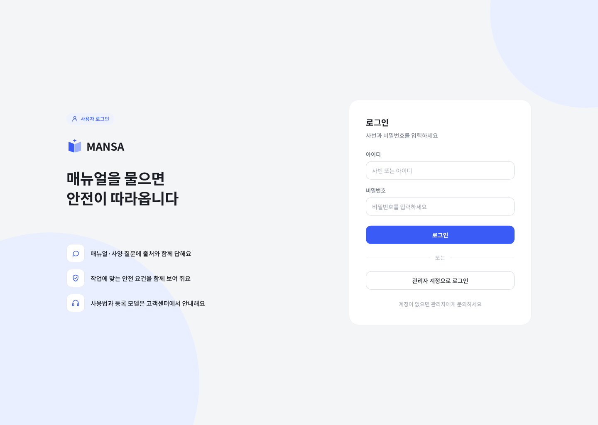
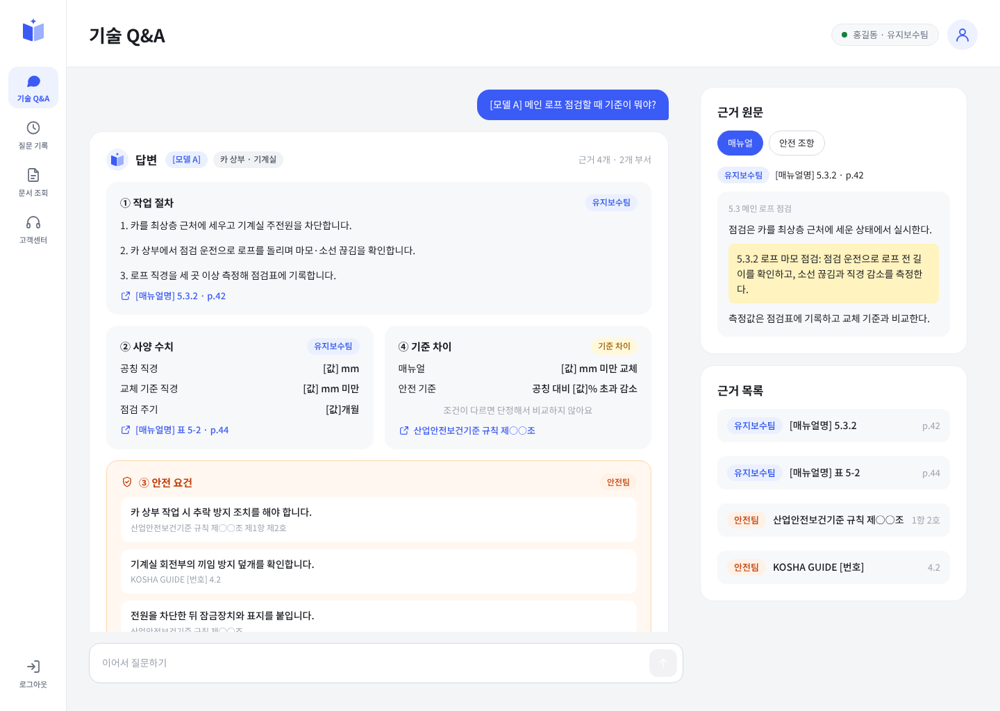
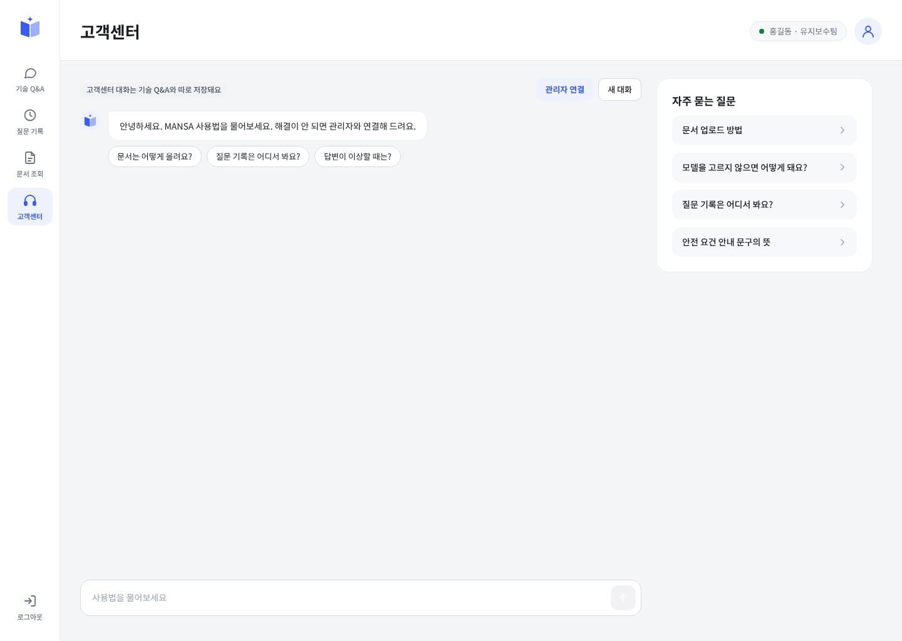
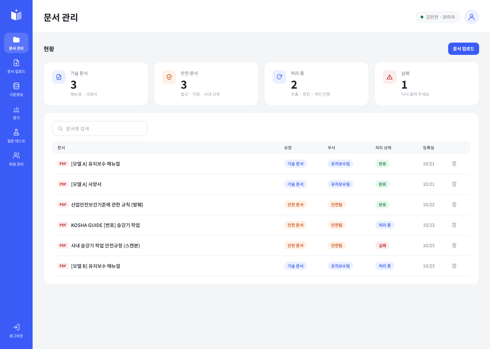
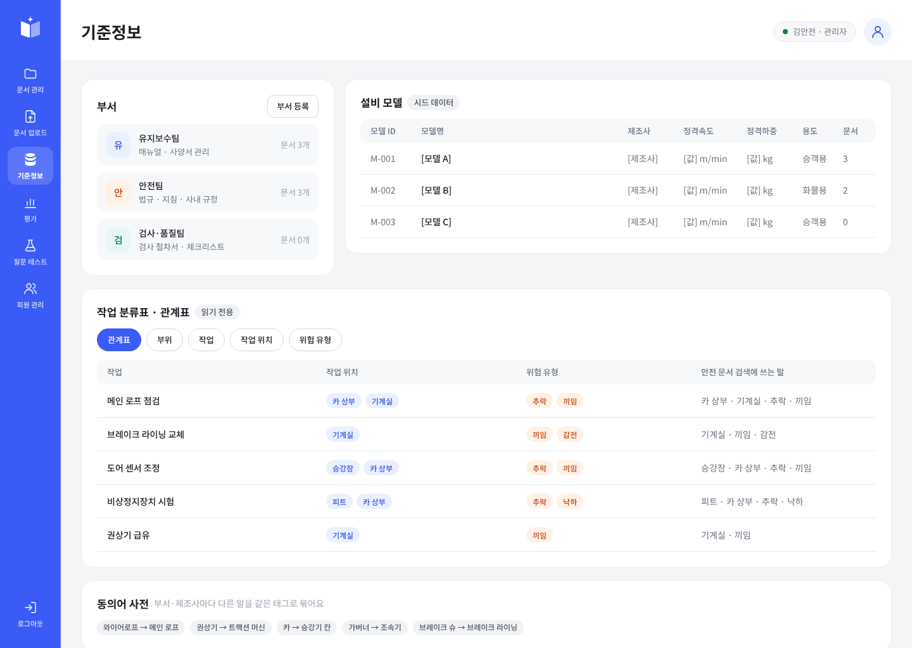

# MANSA

**Manual & Safety Assistant — 매뉴얼을 물으면 안전이 따라옵니다**



## 🔎 MANSA 소개

> 현장 엔지니어가 설비 매뉴얼과 안전 기준을 따로 찾지 않고, 질문 하나로 작업 절차·사양 수치·안전 요건을 출처와 함께 확인하도록 돕는 질의응답 서비스

현대 AI 인사이트 캠퍼스 6팀 프로젝트입니다.

### 현장의 문제

- 작업 절차는 매뉴얼에, 지켜야 할 기준은 법규·지침에 흩어져 있어 하나의 작업을 확인하려면 여러 문서를 열어야 합니다.
- 매뉴얼의 수치와 안전 기준의 수치가 다를 때 어느 쪽을 따라야 하는지 직접 비교해야 합니다.
- 답을 찾아도 근거 문서와 쪽수를 다시 확인해야 믿고 작업할 수 있습니다.

### MANSA는 이렇게 해결해요

1. 흩어진 문서 → 매뉴얼과 안전 문서를 함께 검색해 `작업 절차 · 사양 수치 · 안전 요건`을 한 번에 보여 줍니다.
2. 수치 불일치 → 매뉴얼과 안전 기준의 값을 코드로 비교해 `기준 차이`로 알려 줍니다.
3. 근거 불안 → 답변마다 `출처와 원문`을 오른쪽에 보여 주고, 안전 요건에는 "AI가 찾은 참고 정보이며 최종 판단은 안전관리자 확인"을 함께 표시합니다.
4. 모호한 질문 → 설비 모델이나 부품이 불분명하면 `되묻기`로 범위를 좁히고, 문서에 없는 질문은 `답변 불가`로 안내합니다.

## ✨ 주요 기능

### 사용자

| 메뉴 | 기능 |
| --- | --- |
| 기술 Q&A | 질문하면 작업 절차·사양 수치·안전 요건·기준 차이를 출처와 함께 답변, 근거 원문 확인, 되묻기, 이어서 질문 |
| 질문 기록 | 지난 대화 목록을 보고 누르면 그 대화를 다시 열람 |
| 문서 조회 | 등록된 매뉴얼·안전 문서를 유형·부서·이름으로 찾고 PDF 열기 |
| 고객센터 | MANSA 사용법을 챗봇에게 질문, 해결되지 않으면 관리자 연결 |

### 관리자

| 메뉴 | 기능 |
| --- | --- |
| 문서 관리 | 문서 현황과 처리 상태(처리 중·완료·실패) 확인, PDF 열기, 삭제 |
| 문서 업로드 | PDF를 올리면 유형(기술 문서·안전 문서)과 부서를 지정해 등록 |
| 기준정보 | 부서, 설비 모델, 작업 분류표·관계표, 동의어 관리 |
| 평가 | 질문 세트로 검색·답변 품질을 실행하고 결과 확인, CSV 내보내기 |
| 질문 테스트 | 관리자가 질문을 직접 해 보며 답변 확인(질문 기록에는 남지 않음) |
| 회원 관리 | 회원 등록·수정·삭제와 권한 부여 |

## 🖥️ 화면

| 기술 Q&A · 답변 | 고객센터 |
| :---: | :---: |
|  |  |

| 관리자 · 문서 관리 | 관리자 · 기준정보 |
| :---: | :---: |
|  |  |

> 화면의 문서·수치(`[모델 A]`, `[값]` 등)는 시연용 예시 데이터입니다.

## ⚙️ 동작 방식

```
문서 등록   PDF 업로드 → 텍스트 추출 → 청킹 → 임베딩 → 벡터 DB(Chroma) 색인

질문 처리   질문 입력
            → 질문 분석 (LLM: 설비 모델·작업 파악, 되묻기·답변 불가 판단)
            → 검색 (벡터 + BM25, 분류표·관계표로 검색어 보강)
            → 답변 생성 (LLM: 절차·사양·안전 요건·기준 차이)
            → 출처·수치 검사 후 표시
```

질문 한 번에 LLM은 두 번(질문 분석, 답변 생성) 호출하는 것을 기준으로 설계했습니다.

## 🚧 개발 현황

- **화면:** 사용자·관리자 화면 전체를 `mansa/ui/`에 구현했습니다. 현재는 `ui/mock_data.py`의 목데이터로 동작하며, 각 기능이 완성되면 화면 코드의 목데이터 호출만 실제 함수로 바꿉니다.
- **연결 중:** 로그인·회원 관리, 문서 업로드·처리, 벡터 DB 검색, LLM 질문 분석·답변, 평가 기능을 `mansa/features/`와 `mansa/core/`에 순차적으로 붙이고 있습니다.
- **계속 목데이터:** 고객센터의 관리자 연결은 시연을 위한 화면만 제공합니다.

## 🛠️ Tech Stack & Library

| 기술 / 라이브러리 | 목적 |
| --- | --- |
| **Python 3.11.9** | 개발 기준 언어 버전 |
| **uv** | 가상환경과 패키지 버전을 `pyproject.toml`·`uv.lock`으로 일관되게 관리 |
| **Gradio 6.30** | 질문 입력과 답변 표시 화면을 Python으로 빠르게 구성 |
| **LangChain** (`langchain-openai`) | 프롬프트 → 모델 → 결과 변환을 체인으로 연결해 LLM 호출 |
| **ChromaDB** | 문서 조각의 임베딩 저장과 벡터 검색 |
| **MySQL (Railway)** | 회원·문서·기준정보 등 관계형 데이터 저장 |
| **SQLAlchemy / PyMySQL** | DB 접속과 쿼리 실행 |
| **python-dotenv** | `.env`로 API 키와 접속 정보를 코드 밖에서 관리 |

## 🚀 시작하기

### 준비물

- [uv](https://docs.astral.sh/uv/getting-started/installation/) (Python 3.11.9는 uv가 필요할 때 내려받습니다)
- Git
- 지원 운영체제: macOS / Windows

### 실행

```bash
git clone https://github.com/HYUNDAI-AI-team6/mansa.git
cd mansa/mansa

uv sync --locked
uv run --locked python app.py
```

터미널에 표시되는 주소(기본 `http://127.0.0.1:7860`)를 브라우저에서 엽니다.
지금은 목데이터로 동작하므로 아이디와 비밀번호에 아무 값이나 입력하면 로그인됩니다.
"관리자 계정으로 로그인"을 누르면 관리자 화면으로 들어갑니다.

### 환경변수

DB·LLM·벡터 DB 연결 기능을 사용할 때는 `.env`가 필요합니다. 화면만 확인할 때는 없어도 실행됩니다.

```bash
cp .env.example .env        # Windows: copy .env.example .env
```

`.env`의 값은 팀에서 공유받은 값으로 채웁니다. API 키와 비밀번호는 코드나 커밋에 넣지 않습니다.

| 변수 | 설명 |
| --- | --- |
| `DATABASE_URL` | Railway MySQL 접속 주소 |
| `LLM_API_KEY` | LLM API 키 |
| `LLM_MODEL` | 사용할 LLM 모델 이름 |
| `TECH_CHROMA_HOST` · `SECURE_CHROMA_HOST` · `CHROMA_PORT` | Railway Chroma 벡터 DB 접속 정보 |

### 테스트

```bash
uv run --locked python -B -m unittest discover -s tests -v
```

## 📁 Foldering

```
📁 mansa (저장소)
├── 📁 .github                 # 이슈·PR 템플릿
├── 📁 docs                    # 개발 문서, README 화면 캡처
├── 📝 AGENTS.md               # AI 코딩 도구 공통 규칙
├── 📝 README.md
│
└── 📁 mansa                   # 앱 (uv 프로젝트 루트)
    ├── 📝 app.py              # Gradio 실행 진입점
    ├── 📝 config.py           # 환경변수 읽기
    ├── 📝 pyproject.toml
    ├── 📝 uv.lock
    │
    ├── 📁 core                # DB 연결, LLM 호출 등 공통 핵심 기능
    ├── 📁 features            # 기능별 로직
    │   ├── 📁 auth            #   로그인·회원
    │   ├── 📁 documents       #   문서 관리
    │   ├── 📁 processing      #   PDF 추출·청킹
    │   ├── 📁 llm             #   질문 분석·답변
    │   ├── 📁 retrieval       #   임베딩·검색
    │   └── 📁 dashboard
    ├── 📁 ui                  # Gradio 화면 (login, qa, support, documents, ...)
    │   ├── 📁 assets          #   CSS, 아이콘
    │   └── 📝 mock_data.py    #   기능 연결 전 목데이터
    ├── 📁 util                # MySQL·벡터 DB 접속 도구
    └── 📁 tests
```

폴더별 역할은 [프로젝트 구조 설명서](docs/PROJECT_STRUCTURE.md)에 자세히 정리했습니다.

## 👥 Team

| 이름 | 담당 |
| :---: | --- |
| 류영걸 | MySQL · ChromaDB 연결, 환경 변수, 로그인 · 세션 · 회원 관리, 문서 관리 화면(DB 연결) |
| 박규진 | 관리자 평가(백엔드 · 화면), 고객센터 챗봇, 사용자 문서 조회, 태그 필터 검색, 협업 규칙 |
| 장영균 | 문서 추출 · 청킹 · 태그 · 임베딩 검증, DocumentService(등록 · 조회 · 상태 · 결과 기록) |
| 박정환 | 화면 전체 틀, 기준정보, 문서 처리 파이프라인 · 삭제 · 업로드 흐름 · 화면 연결, 기준 차이 비교 |
| 이세림 | 질문 분석 · QAService 처리 순서 · 답변 불가 · 안전 문구 · 안전 문서 검색, LLM 호출 · 임베딩 |
| 강병훈 | 검색(BM25 · 태그 · RRF) · 답변 생성 · 되묻기 · 질문 기록 · 근거 원문, 기술 Q&A 화면 연결 |

## 📣 Convention

자세한 내용은 [Git 협업 컨벤션](docs/GIT_CONVENTION.md)을 따릅니다.

| 대상 | 형식 | 예시 |
| --- | --- | --- |
| 커밋 | `type: 작업 내용` (한국어) | `feat: 로그인 API 구현` |
| 브랜치 | `type/이슈번호-작업내용` | `feat/17-login-api` |
| 이슈 | `[type] 작업 내용` | `[feat] 로그인 API 구현` |
| PR | `[type] 작업 내용 (#이슈번호)` | `[feat] 로그인 API 구현 (#17)` |

| 타입 | 사용하는 부분 |
| :---: | --- |
| `feat` | 새로운 기능 추가 |
| `fix` | 버그 수정 |
| `design` | CSS 등 사용자 UI 디자인 변경 |
| `refactor` | 기능 변경 없는 코드 구조 개선 |
| `docs` | README 등 문서 작성·수정 |
| `test` | 테스트 코드 추가·수정 |
| `build` | uv 등 빌드·의존성 변경 |
| `chore` | 기타 유지보수·설정 작업 |

### 코드 스타일

Python 3.11 기준이며 패키지는 `uv add`로 추가하고 `uv.lock`은 직접 수정하지 않습니다. 자세한 기준은 [Python 개발 가이드](docs/dev-stack-python.md)를 따릅니다.

## 🐾 Git Flow

**Default Branch & PR Target : `develop`**

`main`에는 직접 푸시하지 않습니다. 모든 작업은 `develop`을 기준으로 진행하고, 개발이 끝나면 `develop`을 `main`에 합칩니다.

```
1. 작업할 내용에 대해 이슈를 만든다. (이슈 제목: [type] 작업 내용)

2. 최신 develop 브랜치에서 새 브랜치를 만든다. (브랜치 이름: type/이슈번호-작업내용)
   - 브랜치를 만들기 전에 develop을 pull 받는다.

3. 만든 브랜치에서 작업하고, 커밋은 하나의 논리적 작업 단위로 쪼개 컨벤션에 맞춰 작성한다.

4. 작업이 끝나면 에러 없이 실행되는지 확인한 뒤 push 한다.
   - PR을 올리기 전에 작업 브랜치에 develop을 pull 받아 충돌을 해결하고 push 하는 것을 권장한다.

5. PR을 작성하고 팀원의 코드 리뷰를 반영한 뒤 develop에 merge 한다.
   - PR 본문에 Closes #이슈번호를 적어 이슈를 연결한다.
   - merge 후 작업 브랜치는 삭제한다.

6. 모든 개발이 끝나면 develop을 main에 합친다.
```

## 📚 문서

- [프로젝트 구조 설명서](docs/PROJECT_STRUCTURE.md)
- [Python 개발 가이드](docs/dev-stack-python.md)
- [Git 협업 컨벤션](docs/GIT_CONVENTION.md)
- [MySQL 연결 가이드](docs/MySqlConnector.md)
- [벡터 DB 연결 가이드](docs/VectorDBConnector.md)
- [AI 코딩 도구 공통 규칙](AGENTS.md)
